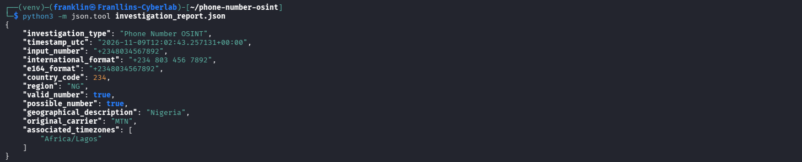
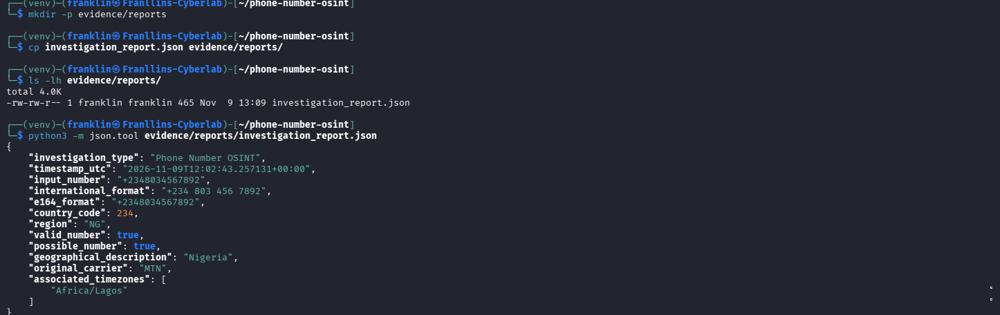
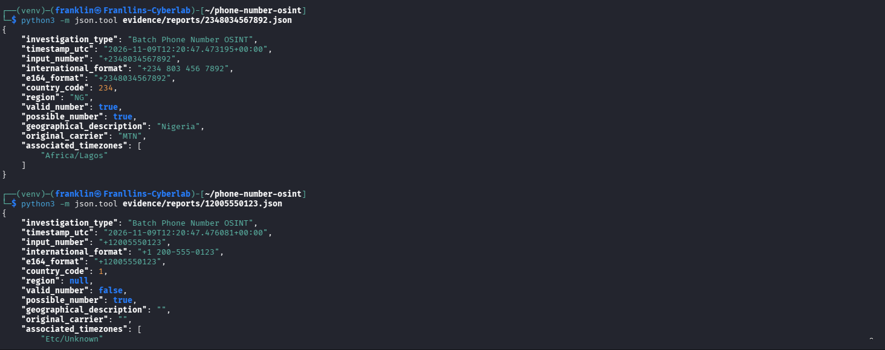
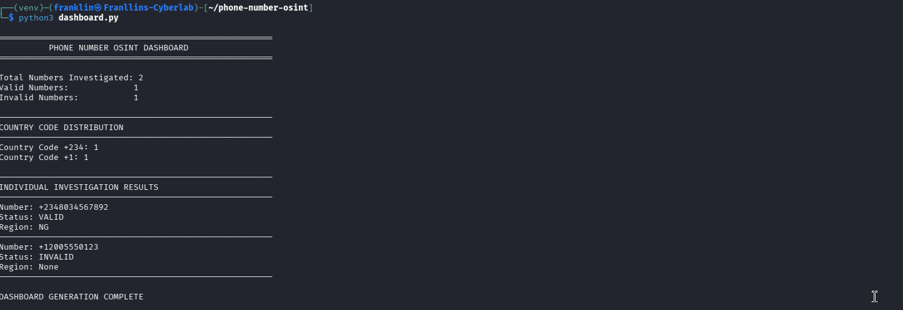
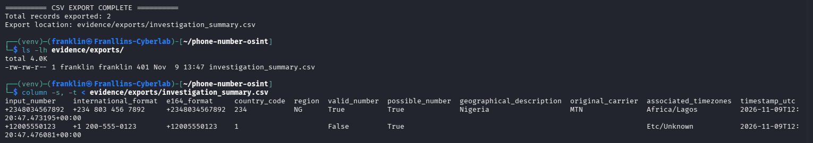
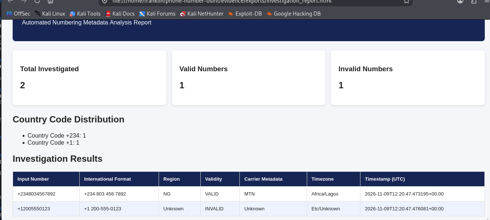

# Phone Number OSINT Investigation Tool

An educational Python-based Open Source Intelligence (OSINT) tool for analysing publicly available phone-number numbering metadata, validating international phone-number formats, and generating structured investigation reports.

## Project Overview

This project demonstrates the application of Python in phone-number OSINT investigations using Google's `phonenumbers` library.

It supports individual and batch phone-number analysis, metadata extraction, automated JSON reporting, investigation dashboards, CSV exports, and HTML report generation.

The project was developed as part of my cybersecurity learning and practical portfolio development.

## Features

- International phone-number parsing and validation.
- E.164 and international number formatting.
- Country and geographical numbering metadata.
- Original carrier metadata lookup.
- Associated timezone identification.
- Individual JSON investigation reports.
- Batch phone-number analysis.
- Investigation summary dashboard.
- CSV investigation report export.
- HTML investigation report generation.
- Error handling for unparseable numbers.
- Automated unit testing.

## Technologies Used

- Python 3
- Google `phonenumbers` library
- JSON
- CSV
- HTML
- Linux / Kali Linux
- Git and GitHub
- Python unittest framework

## Project Structure

```text
phone-number-osint/
│
├── phone_analyzer.py
├── json_report.py
├── batch_analyzer.py
├── dashboard.py
├── csv_export.py
├── html_report.py
│
├── investigation_report.json
├── requirements.txt
├── LICENSE
├── README.md
├── .gitignore
│
├── tests/
│   └── test_analyzers.py
│
└── evidence/
    ├── reports/
    ├── exports/
    └── screenshots/
```

## Installation

Clone the repository:

```bash
git clone https://github.com/Franklin11-11/phone-number-osint.git
cd phone-number-osint
```

Create a virtual environment:

```bash
python3 -m venv venv
```

Activate the environment:

```bash
source venv/bin/activate
```

Install dependencies:

```bash
pip install -r requirements.txt
```

## Usage

### 1. Basic Phone Number Analysis

```bash
python3 phone_analyzer.py
```

### 2. Generate an Individual JSON Report

```bash
python3 json_report.py
```

### 3. Perform Batch Analysis

```bash
python3 batch_analyzer.py
```

Enter phone numbers separated by commas, including their international country codes.

Example:

```text
+2348034567892, +12005550123
```

### 4. View the Investigation Dashboard

```bash
python3 dashboard.py
```

### 5. Export Investigation Results to CSV

```bash
python3 csv_export.py
```

### 6. Generate an HTML Investigation Report

```bash
python3 html_report.py
```

The generated HTML report is saved in:

```text
evidence/exports/investigation_report.html
```

## Automated Testing

The project includes an automated test suite built with Python's built-in `unittest` framework.

The tests cover:

- Valid phone-number analysis.
- Invalid but parseable phone numbers.
- Unparseable phone-number handling.
- Batch report generation.
- Invalid input handling during batch analysis.

Run the automated tests using:

```bash
python -m unittest discover -s tests -v
```

The current test suite contains five tests.

All five tests passed during development.

## Sample Investigation Results

The project was tested using two sample phone-number inputs.

| Input Number | Region | Validation | Original Carrier Metadata | Timezone |
|---|---|---|---|---|
| +2348034567892 | Nigeria | Valid | MTN | Africa/Lagos |
| +12005550123 | Unknown | Invalid | Unknown | Etc/Unknown |

The investigation demonstrated:

- Successful Nigerian phone-number validation.
- Detection of an invalid but parseable number.
- Country-code identification.
- Metadata extraction.
- Batch report generation.
- CSV and HTML report generation.
- Automated validation through unit testing.

## Evidence and Reporting

Investigation outputs are organised into:

- `evidence/reports/` — Individual JSON investigation reports.
- `evidence/exports/` — CSV and HTML investigation exports.
- `evidence/screenshots/` — Screenshots documenting project development and functionality.

## Important Limitations

This tool analyses phone-number numbering metadata. It does not:

- Identify or verify a subscriber's identity.
- Retrieve private subscriber records.
- Track a phone's live GPS location.
- Confirm a number's current mobile network operator.
- Access private telecommunications databases.

Carrier information represents original numbering-library metadata and may not reflect the current network operator because of mobile number portability.

A valid phone number does not establish that a subscriber is active or that the number belongs to a particular person.

## Ethical Considerations

This project is intended for educational purposes, authorised OSINT research, and cybersecurity learning.

Only use phone numbers for which you have appropriate permission or a legitimate lawful basis.

Always respect privacy, applicable laws, and data-protection requirements when handling phone-number information.

## Licence

This project is licensed under the MIT License. See the `LICENSE` file for details.

## Author

**Franklin Chukwuemeka**

Cybersecurity | SOC Analysis | OSINT | Security Research

GitHub: https://github.com/Franklin11-11

## Project Screenshots

### Individual JSON Investigation



### JSON Report Validation



### Batch Analysis



### Investigation Dashboard



### CSV Export



### HTML Investigation Report


